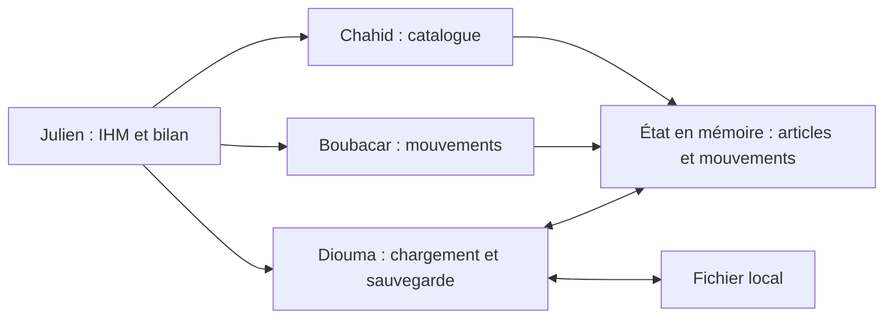

# Stock Dispatch — inventaire et gestion de stock en C

Projet proposé pour le module CESI A3 FISA S3E « Outils de programmation – Langage C ».
Équipe : **Julien, Chahid, Boubacar et Diouma**.

**État au 28 octobre 2026 : cadrage et répartition proposés. Le développement de l'application reste à réaliser après validation du sujet par l'enseignant.** Ce dépôt préparé avec Codex ne représente pas encore les contributions des quatre étudiants.

## Mission et contexte

Un petit atelier doit savoir quels articles il possède, combien sont disponibles et quels mouvements expliquent les quantités présentes. Le logiciel permettra de tenir le catalogue, enregistrer les entrées et sorties, corriger un écart d'inventaire et retrouver les données à la prochaine ouverture.

L'équipe quitte le projet robotique pan-tilt pour privilégier un développement réalisable séparément sur quatre ordinateurs. Le découpage ci-dessous prévoit des fonctions, des jeux d'essai et une démonstration propres à chaque membre. Les fichiers communs sont définis ensemble au démarrage.

Le nom « dispatch » désigne ici l'organisation du projet. L'affectation de matériel à des personnes ou la préparation d'expéditions seraient des fonctionnalités supplémentaires : leur besoin n'est pas encore confirmé.

## Version minimale proposée

1. Ajouter, consulter et rechercher un article par identifiant ou désignation.
2. Enregistrer une entrée ou une sortie, avec refus des quantités invalides et du stock insuffisant.
3. Saisir la quantité réellement comptée lors d'un inventaire et enregistrer l'écart comme une correction explicite.
4. Afficher l'historique et les articles dont la quantité est sous leur seuil minimal.
5. Sauvegarder et recharger l'inventaire avec des erreurs compréhensibles.

Une seule instance du programme modifie un fichier local. Les quantités sont des nombres entiers d'unités. Prix, comptabilité, comptes utilisateurs, synchronisation et gestion de plusieurs entrepôts restent hors du premier périmètre.

**Fonctionnalité avancée proposée : une IHM terminal avec ncurses**, comprenant navigation au clavier, tableau filtrable et formulaire de mouvement. Son acceptation comme fonctionnalité avancée doit être confirmée par l'enseignant ; un simple menu numéroté ne constitue pas à lui seul notre proposition avancée.

## Répartition proposée à quatre

Les affectations sont une proposition à discuter, sans présumer des compétences ou préférences de chacun.

| Membre | Mission technique | Travail autonome | Démonstration propre |
| --- | --- | --- | --- |
| **Chahid** | Catalogue et recherche | Validation des articles, identifiants uniques, ajout, recherche, mise à jour des métadonnées | Ajouter et retrouver un article ; refuser un doublon |
| **Boubacar** | Mouvements et inventaire physique | Entrées/sorties, corrections, historique, invariants des quantités | Faire évoluer un stock ; refuser une sortie impossible sans modifier l'état |
| **Diouma** | Persistance et intégrité | Format du fichier, chargement validé, sauvegarde, erreurs et préservation de l'ancien fichier | Sauver/recharger un état identique ; rejeter un fichier tronqué |
| **Julien** | IHM et bilan de stock | Navigation ncurses, saisies, filtrage, alertes sous seuil et branchement des actions | Parcourir un catalogue d'essai, filtrer les alertes, présenter une erreur lisible |

Chaque personne écrit et explique son code, ses vérifications et sa partie du README. L'intégration et la soutenance sont communes. Voir [les missions détaillées](docs/repartition.md) et [les tâches prêtes à reprendre dans GitHub](docs/taches.md).

## Architecture proposée



Les trois modules métier/fichiers ne s'appellent pas entre eux. Ils reçoivent des structures en paramètres. L'IHM orchestre les appels ; ses premières versions utilisent des données et réponses simulées. Voir [les contrats et règles communes](docs/architecture.md).

Fichiers **à créer pendant le développement** :

| Fichier prévu | Rôle principal |
| --- | --- |
| `include/model.h` | Types, limites, codes de résultat partagés |
| `include/catalog.h`, `src/catalog.c` | Ajout, recherche, modification des métadonnées |
| `include/movement.h`, `src/movement.c` | Entrées, sorties, corrections et historique |
| `include/storage.h`, `src/storage.c` | Lecture et sauvegarde du fichier |
| `include/ui.h`, `src/ui.c`, `src/report.c` | IHM, saisies et liste des articles sous seuil |
| `src/main.c` | Initialisation, chargement, boucle utilisateur et fermeture |
| `tests/test_*.c`, `tests/fixtures/` | Vérifications autonomes et fichiers de test |
| `Makefile` | Compilation et cibles de test séparées |

## Compilation, exécution et dépendances

**Aucun exécutable ni Makefile n'est encore présent.** L'environnement cible proposé est Linux avec compilateur C11, Make et ncurses. Les commandes convenues pour l'implémentation seront :

```sh
make
make test-catalog
make test-movement
make test-storage
make test-report
make test
./bin/stock-dispatch --file data/inventaire.stock
```

Prévoir `-std=c11 -Wall -Wextra -Wpedantic`. La bibliothèque ncurses concerne uniquement l'IHM ; les tests métier et fichiers doivent fonctionner sans ouvrir de terminal interactif. Ce cadrage n'ajoute aucune dépendance installée.

## Démonstration commune attendue

Créer un article avec un seuil de 4 unités ; entrer 10 unités ; en sortir 3 : le stock vaut 7. Refuser une sortie de 8, sans changement. Compter physiquement 2 unités : une correction de −5 apparaît dans l'historique et l'article est signalé sous seuil. Sauvegarder, fermer et recharger : mêmes articles, quantités et historique. Un fichier incorrect produit une erreur et conserve l'état déjà chargé.

Ce scénario est un **critère à vérifier**, pas une démonstration déjà exécutée.

## Consignes et organisation

- [Exigences du cours et preuves attendues](docs/consignes-cesi.md).
- [Répartition, indépendance et intégration](docs/repartition.md).
- [Architecture et contrats](docs/architecture.md).
- [Tâches et critères d'acceptation](docs/taches.md).

Une branche par lot : `catalogue`, `mouvements`, `persistance`, `interface`. Commits courts et explicites, première intégration pendant la première séance, relecture croisée avant fusion. Les dates du rendu et les modalités de soutenance restent à confirmer auprès de l'enseignant.
